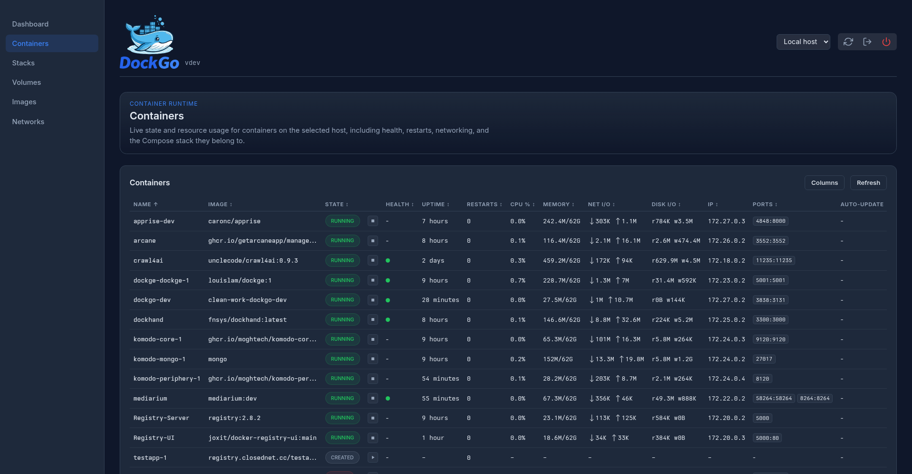

# Dashboard and Resource Pages

The DockGo web UI is made up of a main dashboard and dedicated resource pages.
The sidebar links each page; the host selector in the header applies to all of
them.

- **Dashboard** (`/`): container cards, update checks, and one-click updates
- **Containers** (`/containers`): live container table and start/stop controls
- **Stacks** (`/stacks`): registered Compose stacks with aggregated usage
- **Add Stack** (`/stacks/new`): discover projects and register a stack
- **Volumes** (`/volumes`): volumes with stack and container usage
- **Volume overview** (`/volumes/{name}`): one volume's details and labels
- **Images** (`/images`): local images by repository and tag
- **Networks** (`/networks`): Docker networks with IPAM details

## Main Dashboard

Each container card shows:

- name
- image
- tag
- state
- update availability

Primary action:

- `Update Now`

Secondary actions in the menu:

- start
- stop
- restart
- view logs
- view stack, when the container is managed by a registered stack

## Shared Table Controls

The Containers, Stacks, Images, Volumes, and Networks pages use the same table
behavior:

- click a column heading to sort ascending or descending
- open **Columns** to show or hide columns; choices are saved per page
- tables show 25 rows per page; pagination controls appear when there are more
  than 25 rows
- use **Refresh** to reload the current host's data
- the Containers and Stacks pages also refresh live metrics every 10 seconds

## Containers Page

The Containers page shows:

- name and image
- state and health
- uptime and restart count
- CPU and memory usage
- network and disk I/O
- IP address and published ports
- Compose stack

Use the play/stop button beside the state badge to start or stop a container.
The page refreshes after the action completes.

## Stacks Page

The Stacks page lists registered stacks for the selected host and aggregates
their containers:

- status and running/stopped container counts
- CPU, memory, network, and disk usage
- distinct network and volume counts
- source and working directory

Select the chevron beside a stack name to see its containers and an
**Edit Files** button for its compose and env files; the editor can save a file
by itself or save and deploy the stack in one step. The aggregated status is
simplified to `running`, `stopped`, or `unknown`; the detailed operational
states (`Unbound`, `Drifted`, `Degraded`, and so on) remain in the dashboard's
**Stacks** tab.

### Add Stack

The **Add Stack** button opens `/stacks/new`. That page can:

- discover running Compose projects on the selected host
- prefill the registration form from a discovered project
- register a stack manually with its compose/env files, paths, profiles, and
  update/health policies

Registration uses the same API and validation as the dashboard's Stacks tab.
Editing files, deploying, validating, and history stay in the dashboard's
**Stacks** tab.

## Volumes Page

The Volumes page shows each volume's driver, scope, Compose stack, containers
using it, creation time, and container count.

Expand a row to see the containers using that volume and its Compose stacks.
Select a volume name to open its full overview page, which adds:

- full mountpoint
- containers using the volume with their IDs
- Docker labels

## Images Page

The Images page lists local images one row per repository and tag, with image
ID, creation time, size, and the number of containers using the image. Expand a
row to see the containers using that image, their state, and the Compose stacks
they belong to. The **Prune** and **Prune All** buttons run `docker image prune`
and `docker image prune -a` respectively on the selected host.

## Networks Page

The Networks page shows each network's driver, scope, subnet, gateway, and
attached container count. Subnet and gateway values are empty for networks
without IPAM configuration, such as `host`.

Expand a row to see the containers attached to that network with their IPv4 and
IPv6 addresses and Compose stack, plus a summary of the stacks using it.

## Updating Containers

For standalone containers:

- `Update Now` updates that container directly

For stack-managed containers:

- `Update Now` routes through the registered stack
- the dashboard stays simple, but the backend uses the stack definition

## Logs

Use `View Logs` from the menu to inspect a container directly.

This is useful when:

- an update fails
- a container starts but does not become healthy
- you want to confirm an app migrated correctly after an update

## Reading Common States

- `running`: container is up
- `exited`: container is stopped
- `Update Available`: a newer image is available

Stack-specific operational states such as `Unbound` or `Drifted` appear in the
dashboard's `Stacks` tab, not the main dashboard workflow.

## Safe Usage Tips

- update one or two non-critical apps first
- verify logs after updating stateful apps
- prefer registered stacks for Compose projects
- keep backups for app data before major updates

See [Stacks](./stacks.md) for Compose-specific day-to-day use.
